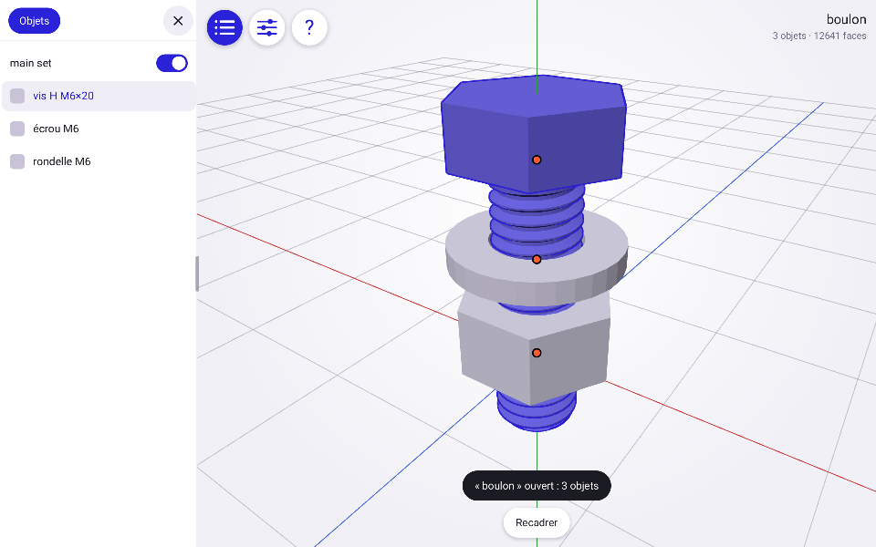

# Rustcraft

L'éditeur 3D de GDA en application Android native, écrite en Rust : ni navigateur,
ni WebView, dans un APK très léger.

## Télécharger

[Dernière version pour Android](https://github.com/s1pierro/rustcraft/releases/latest) :
ouvrez la page, puis touchez le fichier `.apk`.

## État

Version 0.39 : **édition en modes Scène, Géométrie et Pose, armatures, modifieurs, visserie, UV et matériaux**.

- Projets `.gda` des formats 1 à 10, fichiers OBJ, STL, glTF et GLB ; Rustcraft écrit
  le format 10, que GDA n'ouvre pas
- Rendus Solide, En jeu et Rayons X, éclairage de GDA
- Textures PNG et JPEG à l'import : un `.glb` les contient, un `.obj` se choisit avec
  son `.mtl` et ses images ; visibles en rendu En jeu, gardées dans le `.gda` et à
  l'export : intégrées au GLB, en `.mtl` et images à côté de l'OBJ
- Sélection multiple, poignées de translation, rotation et échelle, axes, pas, pivots
- Annulation sur 60 étapes, à travers les deux modes
- Saisie chiffrée de la position, de la rotation et des dimensions, au pavé numérique
  déplaçable : reprise de la valeur, curseur, passage au champ suivant, mode
  alphanumérique
- Primitives paramétrables, réglées dans un panneau avec aperçu sur le curseur 3D :
  cube, sphère, icosphère, cylindre, cône
- Visserie ISO de M2 à M24 : vis et boulons, écrous, rondelles, tiges filetées, avec
  paramètres détaillés pour l'impression 3D (1 unité = 1 mm)
- Modifieurs booléen (différence, union, intersection) et répétition, dans leur panneau
  et sa pastille : maillage de base inchangé, résultat calculé à part, cible
  en fil de fer, matériaux et UV conservés, appliqués à l'export, à figer par Appliquer
- Duplication, suppression, renommage des objets et du projet, application de l'échelle
- Mode Géométrie sur un ou plusieurs objets : sommets, arêtes et faces, sélection au
  toucher, en boîte, par chemin, éléments liés, conversions
- Opérations : créer, supprimer, inverser, trianguler, séparer, dissoudre, subdiviser,
  boucle de coupe, fusionner, révolution, avec réglage de la dernière opération
- Pastille Contexte : fiche de l'objet ou de la géométrie, et onglet Dernière opération
  pour refaire la dernière transformation ou opération avec d'autres valeurs
- Aide des opérations tirée du catalogue, avec la disponibilité selon la sélection
- Barre rapide au-dessus des outils : les opérations qui s'appliquent à la sélection,
  à choisir dans Réglages › Barre rapide
- Réglages › Couleurs : les couleurs de l'interface et de la vue 3D, comme dans GDA
- Pastille Scène : rendu, vue et ajouts à la scène, et onglet Matériaux, aussi en mode
  Géométrie : réglages du matériau de l'objet actif, bibliothèque du projet, création,
  duplication, renommage, suppression, image PNG ou JPEG choisie depuis l'appareil
- Vue UV du mode Géométrie, à côté du modèle : points et îlots, coins liés ou séparés,
  sélection au toucher et en boîte, déplacement, rotation, échelle, axes U et V, pas et
  annulation, zoom à deux doigts ; le modèle montre la texture et suit chaque geste
- Projections UV selon la vue, en cube, cylindre ou sphère, sur les faces choisies ou
  toutes, à la forme de l'image, axe réglable ; un damier montre l'étirement sans texture
- Mise en page UV : les îlots de la vue rangés dans l'image sans chevauchement, à la
  plus grande échelle qui tienne, même densité et rotation au choix, marge réglable
- Coutures et dépliage LSCM : marquer ou effacer des coutures sur les arêtes, en rouge
  sur le modèle, ou les tirer des UV existantes ; déplier les faces choisies ou toutes
  avec le moins de déformation possible, à la densité du modèle, à l'endroit et le haut
  en haut, puis ranger les morceaux, image par image ; enregistrées dans le `.gda`
- Sets : pliage, visibilité, création, renommage, fusion et suppression dans la liste
  des objets ; un appui long sur un objet le déplace vers un set, avec la sélection
- Armatures : une armature d'un os ou un humanoïde de 19 os, ajoutés sur le curseur 3D ;
  leur géométrie, ce sont leurs os, édités en mode Géométrie : bouts et corps des os au toucher ou en boîte,
  bouts soudés, déplacement, rotation et échelle, ajout, extrusion, suppression, parent,
  nom et longueur, limites de rotation par axe (libre, limitée en degrés depuis le repos,
  bloquée), montrées en secteurs à la tête de l'os ; dans la pastille Os, les armatures et l'arbre de leurs os, dépliables, un appui long y choisit toute une descendance ; en mode Scène, cette pastille
  montre l'armature active : nom, objets liés, os posés, retour au repos, poids d'un os
  de l'arbre ; « Au premier plan », dans Contexte › Objet, les montre et les fait toucher
  à travers les autres objets en mode Scène ; gardées dans le `.gda`
- Liaison des objets aux armatures, dans Contexte › Objet : à tous les os, à un groupe
  ou à un seul ; l'armature emporte ses objets ; enregistrée dans le `.gda`
- Mode Pose, dont la pilule apparaît quand une armature est active : les os tournent
  autour de leur tête, selon les axes de l'os actif posé, à la poignée comme aux trois
  curseurs d'angle de l'os actif (plier en X et Z, vriller en Y), dans ses limites, que
  ses anneaux montrent en secteurs, sans anneau pour un axe bloqué ; en manipulation
  Tirer, au bouton de la barre du bas, on saisit directement un os et la chaîne qui le
  relie à l'ancre se plie pour le suivre, dans les limites, comme la marionnette de GDA ;
  l'ancre reste fixe dans le monde, la racine par défaut, « Ancrer ici » sur l'os actif ; le panneau Os ne garde
  que la pose ; « Sauvegarder la pose » la garde dans l'onglet Catalogue, d'où elle se
  rappelle, se renomme, se remplace ou se supprime ; un objet lié à
  un seul os le suit, un objet lié à un groupe se déforme selon des poids automatiques
  (diffusion de chaleur sur la surface, 4 os au plus par sommet), recalculés quand le
  maillage ou les os changent ; pose gardée dans le `.gda`, retour au repos par os ou en
  bloc ; poids de l'os actif en couleur sur les objets
- Curseur 3D : vers l'origine, vers la sélection, sélection vers le curseur
- Panneau Fichier à trois onglets : Projet (nom, enregistrement `.gda`, ouverture,
  nouvelle scène), Importer par le sélecteur d'Android, Exporter en OBJ, STL ou GLB la
  scène complète ou les seuls objets choisis, et `.mtl`, dans Téléchargements
  (Android 10 ou plus) ; sauvegarde automatique d'un lancement à l'autre

Pas encore disponibles : curseur 3D à la main ; limites de translation des armatures,
conservées dans le projet mais ni éditables ni appliquées ; poids à la main.
Les limites de rotation suivent l'ordre des curseurs (X, puis Z, puis la vrille Y) ;
GDA compose ses angles dans l'ordre X, Y, Z.
Les armatures et les poids ne sont pas exportés, et les objets s'exportent au repos. En mode Géométrie, les objets sont édités sans leurs
modifieurs.

## Ouvrir un fichier

Depuis le panneau Fichier, ou depuis un gestionnaire de fichiers : **Ouvrir avec** ou
**Partager**, puis Rustcraft.

## Organisation

- `src/maillage.rs`, `json.rs`, `projet.rs`, `texture.rs` : le modèle, sans dépendance
  graphique
- `src/actions.rs` : le catalogue des opérations, source des panneaux, de l'aide et de la barre rapide
- `src/edition.rs` : poses, pivots, gestes, annulation, sans interface
- `src/geometrie.rs` : sélection et opérations du mode Géométrie, sans interface
- `src/booleens.rs`, `modifs.rs` : opérations booléennes et évaluation des modifieurs
- `src/primitives.rs`, `visserie.rs` : réglages des primitives, pièces de visserie
- `src/armature.rs` : os, hiérarchie, pose, limites, bouts soudés et sélection des os, sans interface
- `src/marionnette.rs` : saisie directe d'une armature posée, l'ancre restant fixe, sans interface
- `src/peau.rs` : poids automatiques et déformation des objets liés à un groupe d'os, sans interface
- `src/uv.rs` : points, îlots et transformations des coordonnées de texture, sans interface
- `src/vue.rs`, `editeur.rs` : du modèle à l'écran, et l'interface de l'éditeur
- `src/ui.rs`, `shell.rs`, `widgets.rs`, `draw.rs`, `text.rs` : le socle d'interface,
  venu de [Rustine](https://github.com/s1pierro/Rustine)
- `src/gles.rs`, `renderer.rs`, `android.rs` : OpenGL ES et Android
- `java/` : la seule classe Java, qui reçoit le résultat du sélecteur de fichiers
- `examples/apercu.rs` : dessine l'application hors écran, sur le processeur
  graphique de l'appareil

## Tests

    cargo test

`tests/differentiel.rs` rejoue dans le portage Rust les opérations de
`tests/reference.json`, produit par le vrai moteur de GDA, et exige les mêmes
maillages et les mêmes fichiers OBJ, STL et GLB, puis les mêmes poses, pivots,
angles et opérations de géométrie que les vraies méthodes de l'éditeur. Pour le régénérer :

    node tools/reference.js <dossier de GDA> tests/reference.json

`tests/visserie.rs` compare les pièces et les booléens à `tests/visserie.json`, produit
par le vrai `visserie.js` et le vrai Manifold de GDA :

    node tools/reference-visserie.js <dossier de GDA> tests/visserie.json

`tests/armature.rs` rejoue des suites d'opérations sur des armatures et les compare à
`tests/armature.json`, produit par le vrai `moteur/armature.js` de GDA :

    node tools/reference-armature.js <dossier de GDA> tests/armature.json

`tests/marionnette.rs` rejoue des saisies directes et les compare à `tests/marionnette.json`,
produit par le vrai `moteur/marionnette.js` (ancres diverses, articulations soudées) :

    node tools/reference-marionnette.js <dossier de GDA> tests/marionnette.json

`tests/peau.rs` compare les poids et les déformations à `tests/peau.json`, produit par le
vrai `moteur/peau.js` :

    node tools/reference-peau.js <dossier de GDA> tests/peau.json

`tools/icones.py` régénère `src/icones.rs` depuis les pictogrammes de GDA.

`tools/projets.js` prépare la vérification de vrais projets par `tests/projets.rs`.

## Dépendances

`png` et `jpeg-decoder` décodent les images des textures. `boolmesh` (MPL-2.0) calcule
les opérations booléennes.

## Construire l'APK

Dans [Termux](https://termux.dev), avec le Rust natif :

    pkg install rust aapt apksigner zip unzip curl openjdk-17 d8
    bash build.sh

L'APK est produit dans `dist/rustcraft.apk`. La compilation a lieu dans
`~/.cache/rust-apk/rustcraft`.

## Licence

Rustcraft est réutilisable, modifiable et redistribuable à des fins non
commerciales, selon la [PolyForm Noncommercial License 1.0.0](LICENSE.md). Pour un
usage commercial, contactez l'auteur.
